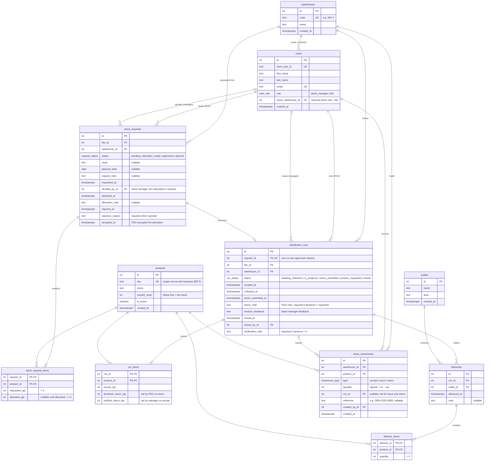

# StockFlow Backend 

> Part of fullstack development bootcamp by Stemlink

The API and database for **StockFlow**, a warehouse stock and distribution tracker for a beverage manufacturer with seven warehouses and about 700 field distribution officers (FDOs).

**Stack:** Node.js, Express 5, TypeScript, Drizzle ORM, PostgreSQL, Zod. Authentication is handled by Clerk

---

## Database design

### ER diagram



### Tables

| Table                                    | Purpose                                                                                                                                                                        |
| ---------------------------------------- | ------------------------------------------------------------------------------------------------------------------------------------------------------------------------------ |
| `warehouses`                             | The warehouses.                                                                                                                                                                |
| `products`                               | Product lines, identified by a business-wide unique `sku`. `reorder_level` drives the "Low Stock" badge on the Stock Summary page.                                             |
| `users`                                  | One row per Clerk user. `role` mirrors the Clerk `publicMetadata.role`. FDOs must have a `home_warehouse_id`. Stock managers have network-wide access, so they don't need one. |
| `outlets`                                | Shops the FDO picks from when recording a delivery. This is pre-loaded reference data, not managed in the app.                                                                 |
| `stock_requests` + `stock_request_items` | An FDO's request for a day's stock, and the manager's allocation per product.                                                                                                  |
| `distribution_runs` + `run_items`        | What the FDO actually carries for the day, and how the return was declared and verified.                                                                                       |
| `deliveries` + `delivery_items`          | Each outlet drop-off during a run.                                                                                                                                             |
| `stock_movements`                        | The stock ledger. It is the only place stock levels come from.                                                                                                                 |

---

## Authentication

Clerk signs users in on both the web app (`@clerk/react`) and the FDO mobile app (`@clerk/expo`). The API never sees a password. It only checks the session token Clerk issued.

```
client: getToken()  ->  Authorization: Bearer <jwt>  ->  clerkMiddleware()  ->  attachUser  ->  route
                                                         checks signature       finds or creates
                                                         and expiry             the users row
```

- `clerkMiddleware()` (in `src/server.ts`) runs on every request. It verifies the token, but it doesn't block anyone.
- `attachUser` (in `src/middlewares/attach-user.ts`) is added to the routes that need to know the caller. It sends `401` without a valid session. It sends `403` when the user can't be let in yet: no role, an unknown role, or an FDO without a home warehouse. Otherwise it sets `req.user`.
- A user's `users` row is created on their first request, from the session token's claims (`src/lib/current-user.ts`). The row is updated whenever their role, warehouse or name changes in Clerk.

### Clerk setup

1. Copy the keys from Clerk dashboard → API keys into `.env` (see `.env.example`).
2. Go to Clerk dashboard → Sessions → Customize session token, and add these claims:

   ```json
   {
     "role": "{{user.public_metadata.role}}",
     "warehouse": "{{user.public_metadata.warehouse}}",
     "email": "{{user.primary_email_address}}",
     "firstName": "{{user.first_name}}",
     "lastName": "{{user.last_name}}"
   }
   ```

3. Set each user's public metadata. FDOs need a warehouse code that exists in `warehouses`:
   - Stock manager: `{ "role": "stock-manager" }`
   - FDO: `{ "role": "fdo", "warehouse": "WH-1" }`

### Calling the API with a token

Sign in to the web app, open the browser console, and run `await Clerk.session.getToken()`. Paste the result into the `token` variable of the Bruno `Local` environment. Clerk tokens expire after 60 seconds, so copy a fresh one when you get a 401.

### Commands

```sh
npm test          # unit tests (claims -> profile)
npm run jwt:demo  # sign, verify, tamper with and expire a JWT using jose
```
